# Real-Time & Batch Geopolitical Lakehouse Workshop
### End-to-End Enterprise Lakehouse Architecture with GDELT 2.0, Kafka, MongoDB, Apache Spark, Apache Iceberg, Hive Metastore, PrestoDB, Apache Airflow & Apache Superset


-47A248?style=for-the-badge&logo=mongodb)
-231F20?style=for-the-badge&logo=apachekafka)


---

## 👨‍🏫 Instructor's Welcome

Welcome to the **GDELT (Global Database of Events, Language, and Tone) Real-Time & Batch Geopolitical Lakehouse Workshop**! 

In enterprise data engineering, modern data systems face a fundamental dilemma:
* **The Operational Need ("What is happening right now?"):** Stakeholders demand sub-second visibility into breaking events, requiring frequent small writes, point lookups, and indexed timelines.
* **The Analytical Need ("What are the macro trends over time?"):** Analysts and ML models require multi-year scans across tens of millions of rows, columnar compression, partition pruning, and low-cost storage.

Traditional data warehouses fail at fast individual upserts, while operational NoSQL databases fail at multi-terabyte analytics scans. 

In this workshop, you will build and operate the industry-standard solution: a **hybrid hot-tier / cold-tier Lakehouse**. You will ingest live world event data from the public **GDELT 2.0** project, stream breaking news into **MongoDB (Hot Tier)** via **Kafka & Kafka Connect**, bulk-load historical archives into **Apache Iceberg on MinIO (Cold Tier)** via **Apache Spark**, orchestrate continuous micro-batch syncs with **Apache Airflow**, and serve a single, zero-duplicate SQL view across both tiers using **PrestoDB** and **Apache Superset**.

---

## 📑 Table of Contents

1. [Architecture Blueprint](#1-architecture-blueprint)
2. [Component Directory & Resource Budget](#2-component-directory--resource-budget)
3. [Quickstart: 5-Minute Environment Setup](#3-quickstart-5-minute-environment-setup)
4. [The Data: GDELT 2.0 Event Stream](#4-the-data-gdelt-20-event-stream)
5. [Hands-On Workshop Lab Modules](#5-hands-on-workshop-lab-modules)
   - [Lab 0: Cluster Bootstrapping & Health Verification](#lab-0-cluster-bootstrapping--health-verification)
   - [Lab 1: Streaming Ingestion (GDELT → Kafka → MongoDB)](#lab-1-streaming-ingestion-gdelt--kafka--mongodb)
   - [Lab 2: Operational Hot Tier & Presto Schema Pinning](#lab-2-operational-hot-tier--presto-schema-pinning)
   - [Lab 3: Historical Batch Backfill (Spark → Iceberg Silver)](#lab-3-historical-batch-backfill-spark--iceberg-silver)
   - [Lab 4: Lakehouse Storage Internals & Hive Metastore](#lab-4-lakehouse-storage-internals--hive-metastore)
   - [Lab 5: Incremental Lakehouse Sync & Change Watermarking](#lab-5-incremental-lakehouse-sync--change-watermarking)
   - [Lab 6: Data Quality Gates & Orchestration in Airflow](#lab-6-data-quality-gates--orchestration-in-airflow)
   - [Lab 7: Zero-Duplicate Federated Serving in Presto](#lab-7-zero-duplicate-federated-serving-in-presto)
   - [Lab 8: BI Dashboards in Apache Superset](#lab-8-bi-dashboards-in-apache-superset)
   - [Lab 9: Cleanup](#lab-9-cleanup)
6. [Core Architectural Deep-Dives](#6-core-architectural-deep-dives)
7. [Repository Map](#7-repository-map)
8. [Troubleshooting & Operations Guide](#8-troubleshooting--operations-guide)

---

## 1. Architecture Blueprint

### 1.1 End-to-End System Diagram

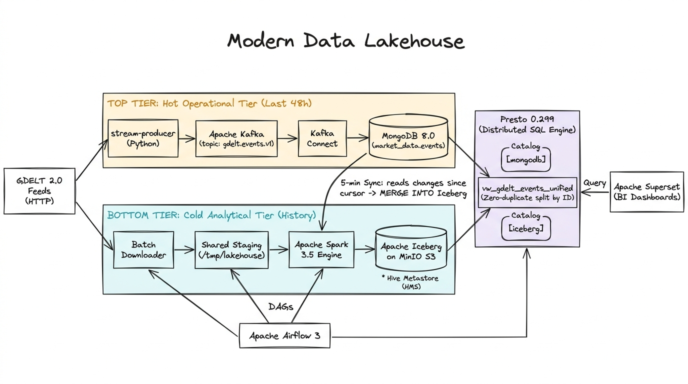

### 1.2 Data Flow Topology

```text
                                  PUBLIC INTERNET (GDELT 2.0)
                                               │
             ┌─────────────────────────────────┴─────────────────────────────────┐
             │ Streaming Path (Every 60s)                                        │ Batch Path (Historical)
             ▼                                                                   ▼
   [stream-producer]                                                   [batch-downloader]
  (Python 3.12 Poller)                                                (Parallel Slice Pull)
             │                                                                   │
             ▼                                                                   ▼
    [Apache Kafka 4.3]                                                 Shared Staging Volume
 (Topic: gdelt.events.v1)                                            (/tmp/lakehouse/landing)
             │                                                                   │
             ▼                                                                   ▼
   [Kafka Connect Sink]                                                 [Apache Spark 3.5]
(mongo-kafka-connect-3.1)                                             (load_archives_to_iceberg.py)
             │                                                                   │
             ▼ (Upsert _id)                                                      ▼ (ACID MERGE INTO)
┌─────────────────────────┐                                           ┌─────────────────────────┐
│   HOT TIER: MongoDB     │────── 5-Minute Incremental Sync ─────────▶│    COLD TIER: Iceberg    │
│    (Operational DB)     │         (sync_mongo_to_iceberg.py)        │   (Parquet on MinIO S3) │
│ • market_data.events    │                                           │ • silver_gdelt.events   │
│ • TTL: ~48 Hours        │                                           │ • gold_gdelt.*          │
└─────────────────────────┘                                           └─────────────────────────┘
             ▲                                                                   ▲
             │                                                                   │
             └───────────────────────┬───────────────────────────────────────────┘
                                     │ Federated SQL Queries
                                     │ (Cross-Catalog Serving View)
                                     ▼
                      ┌─────────────────────────────┐
                      │    PrestoDB 0.299 Cluster   │
                      │ 1 Coordinator + 2 Workers   │
                      │ (Catalog: mongodb & iceberg)│
                      └─────────────────────────────┘
                                     │
                                     ▼
                      ┌─────────────────────────────┐
                      │    Apache Superset 6.1      │
                      │  (Executive BI Dashboards)  │
                      └─────────────────────────────┘
```

### 1.3 Presto in the Open Lakehouse Ecosystem

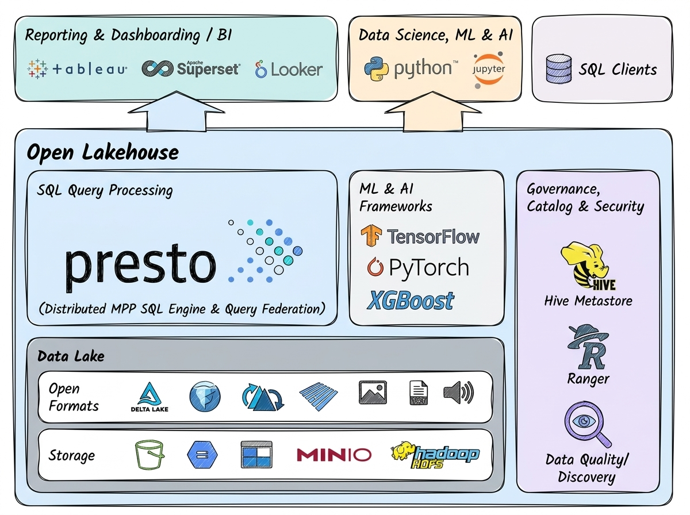

### 1.4 Why Two Tiers? (Lambda Architecture)

This design is a **Lambda architecture**: a fast streaming path and a complete batch path, merged at query time. Each tier does what it is best at:

| Tier | In this workshop | Good at | Bad at |
|:---|:---|:---|:---|
| **Hot** | MongoDB | Fresh data within minutes, fast lookups by ID, constant small writes | Big scans and aggregations over months or years |
| **Cold** | Apache Iceberg on MinIO | Cheap storage, columnar scans over millions of rows, ACID snapshots | Thousands of tiny writes per minute (each commit writes new files) |
| **Query** | PrestoDB | One SQL query across both tiers, no data copying | Storing data itself |

It is not the only option. See [6.3 Alternative Architectures](#63-alternative-architectures) for what other teams use and what each would replace here.

### 1.5 Data Layers (Medallion Architecture)

```text
 Raw (≈ Bronze)              Silver                    Gold                      Serving
 GDELT CSVs ──Spark──▶  silver_gdelt.events ──▶ gold_gdelt.* (3 tables)
 Kafka → MongoDB ─sync─▶        │
                                └────────────────────────────────────▶ vw_gdelt_events_unified
                 MongoDB (not yet synced) ───────────────────────────▶  (Silver + hot tier)
```

* **Silver** (`silver_gdelt`): cleaned, deduplicated events from both paths. The source of truth.
* **Gold** (`gold_gdelt`): aggregated tables built **only from Silver**, one per analytical question. Always rebuildable.
* **Serving** (`gdelt_serving`): the unified view over Silver plus unsynced MongoDB events. There is no Bronze table; raw files and Kafka play that role.

---

## 2. Component Directory & Resource Budget

The entire pipeline runs on **13 orchestrated Docker containers** on a single workstation:

| # | Service Name | Image | Host Port | Internal DNS | Role & Memory Limit |
|:--|:---|:---|:---|:---|:---|
| 1 | `postgres` | `postgres:17` | `5432` | `postgres:5432` | Metastore, Airflow & Superset backend DB (512 MB) |
| 2 | `minio` | `cgr.dev/chainguard/minio:latest` | `9000`, `9001` | `minio:9000` | S3-compatible Object Storage for Iceberg warehouse (512 MB) |
| 3 | `mongodb` | `mongo:8.0` | `27017` | `mongodb:27017` | Operational Hot Tier (Single-node Replica Set `rs0`) (1.5 GB) |
| 4 | `kafka` | `apache/kafka:4.3.1` | `9092` | `kafka:9092` | Event Streaming Broker in KRaft mode (1.0 GB) |
| 5 | `kafka-connect` | `apache/kafka:4.3.1` | `8083` | `kafka-connect:8083` | Self-bootstrapping MongoDB Sink Connector (1.0 GB) |
| 6 | `hive-metastore` | `apache/hive:3.1.3` | `9083` | `hive-metastore:9083` | Iceberg HMS Catalog on PostgreSQL (1.0 GB) |
| 7 | `spark-master` | `apache/spark:3.5.9` | `7077`, `8082`, `8084` | `spark-master:7077` | Consolidated Spark Master + 4-Core Worker (4.0 GB) |
| 8 | `presto-coordinator` | `prestodb/presto:0.299` | `8080` | `presto-coordinator:8080` | Federated SQL Coordinator & Query Planner (1.4 GB) |
| 9 | `presto-worker-1` | `prestodb/presto:0.299` | — | `presto-worker-1:8080` | Distributed Query Execution Worker 1 (1.8 GB) |
| 10 | `presto-worker-2` | `prestodb/presto:0.299` | — | `presto-worker-2:8080` | Distributed Query Execution Worker 2 (1.8 GB) |
| 11 | `airflow` | `apache/airflow:3.3.2` | `8081` | `airflow:8080` | Workflow Orchestration Engine (Standalone) (3.0 GB) |
| 12 | `superset` | `apache/superset:6.1.0` | `8088` | `superset:8088` | BI Visualization & Dashboarding Layer (1.5 GB) |
| 13 | `stream-producer` | `python:3.12-slim` | — | — | GDELT Live Poller & Kafka Ingestion Agent (256 MB) |

> [!NOTE]
> **Total Cluster Memory Cap:** $\approx 19.25\text{ GB}$ (limits). Idle working set requires $\approx 10\text{–}12\text{ GB}$ of actual RAM. In Docker Desktop Settings, allocate at least **12 GB RAM** and **4–6 CPU cores**.

---

## 3. Quickstart: 5-Minute Environment Setup

### 3.1 Prerequisites
* [Docker Desktop](https://www.docker.com/products/docker-desktop/) installed and running (macOS, Linux, or Windows WSL2).
* At least **12 GB RAM** assigned to Docker Desktop (`Settings` $\rightarrow$ `Resources` $\rightarrow$ `Memory`).
* Ports `8080`, `8081`, `8082`, `8083`, `8088`, `9000`, `9001`, `9092`, and `27017` available on your host machine.

### 3.2 1-Command Startup
```bash
# 1. Clone the repository
git clone https://github.com/saurabhmahawar/presto_mongodb_workshop.git
cd presto_mongodb_workshop

# 2. Copy the default environment file
cp .env.example .env

# 3. Launch the complete 13-service stack
docker compose up -d
```

> [!TIP]
> **First Startup Timing:** On the very first run, Docker downloads container images and initial Spark JARs. It typically takes 2–4 minutes for all health checks to turn green.

### 3.3 Access Directory & Default Credentials

| Interface | URL | Credentials | Purpose |
|---|---|---|---|
| **Superset BI** | [http://localhost:8088](http://localhost:8088) | `admin` / `admin` | Interactive Maps, Charts & Hot/Cold Dashboards |
| **Airflow Orchestrator** | [http://localhost:8081](http://localhost:8081) | `admin` / `admin` | DAG Schedules, Task Runs & Pipeline Logs |
| **PrestoDB Web UI** | [http://localhost:8080](http://localhost:8080) | *(No login)* | Query Execution Graphs, Splits & Node Telemetry |
| **Spark Master UI** | [http://localhost:8082](http://localhost:8082) | *(No login)* | Spark Workers, Memory Allocation & Active Jobs |
| **MinIO Console** | [http://localhost:9001](http://localhost:9001) | `minioadmin` / `minioadmin` | Object Browser (`s3a://lakehouse/warehouse`) |
| **Kafka Connect REST** | [http://localhost:8083/connectors](http://localhost:8083/connectors) | *(No login)* | Connector Health & Status JSON |

---

## 4. The Data: GDELT 2.0 Event Stream

The **Global Database of Events, Language, and Tone (GDELT 2.0)** monitors global broadcast, print, and web news in over 100 languages, translating and coding events in real-time according to the **CAMEO (Conflict and Mediation Event Observations)** taxonomy.

* **Upstream Source:** `http://data.gdeltproject.org/gdeltv2/lastupdate.txt`
* **Publication Cadence:** Every 15 minutes (96 export files per day).
* **Format:** Tab-separated headerless CSV containing 61 columns per event.

### Key Columns Extracted by our Pipeline

| Field Name | Type | Description |
|:---|:---|:---|
| `global_event_id` | `BIGINT` | Globally unique ID assigned by GDELT. **Primary Key across all tiers.** |
| `event_date` | `DATE` | Event publication date (`YYYYMMDD`). Used for partitioning Iceberg. |
| `event_time` | `TIMESTAMP` | Precise event timestamp from GDELT `DATEADDED`. Used for sorting and hot-tier TTL. |
| `actor1_name` / `actor2_name` | `STRING` | Identities of actors involved (e.g. `UNITED STATES`, `PROTESTERS`). |
| `event_code` | `STRING` | CAMEO event code (e.g., `030` = Discuss/Meet, `190` = Military Force). |
| `quad_class` | `INT` | High-level classification: `1` Verbal Coop, `2` Material Coop, `3` Verbal Conflict, `4` Material Conflict. |
| `goldstein_scale` | `DOUBLE` | Geopolitical stability impact score: `-10.0` (extreme destabilization) to `+10.0` (maximum stabilization). |
| `num_mentions` | `INT` | Total article mentions across global media outlets in the publication window. |
| `avg_tone` | `DOUBLE` | Sentiment score ranging from `-100.0` (extremely negative) to `+100.0` (extremely positive). |
| `action_country` | `STRING` | Normalized 3-letter ISO-3 country code where the action occurred (converted from FIPS 10-4). |
| `latitude` / `longitude` | `DOUBLE` | Geographic coordinates of the event location (`NULL` if unmapped). |

---

## 5. Hands-On Workshop Lab Modules

Follow these 10 guided lab modules to explore, operate, and query the entire pipeline.

---

### Lab 0: Cluster Bootstrapping & Health Verification

**Goal:** Ensure all 13 services are healthy and communicating.

Run the verification command from your terminal:
```bash
docker compose ps
```
You should see all 13 containers in state `Up` or `Up (healthy)`.

Verify the distributed Presto cluster (1 Coordinator + 2 Workers):
```bash
docker exec presto-coordinator presto-cli --output-format ALIGNED --execute "SELECT node_id, coordinator, state FROM system.runtime.nodes;"
```
*Expected Output:* 3 active nodes (1 coordinator: `true`, 2 coordinator: `false`).

---

### Lab 1: Streaming Ingestion (GDELT → Kafka → MongoDB)

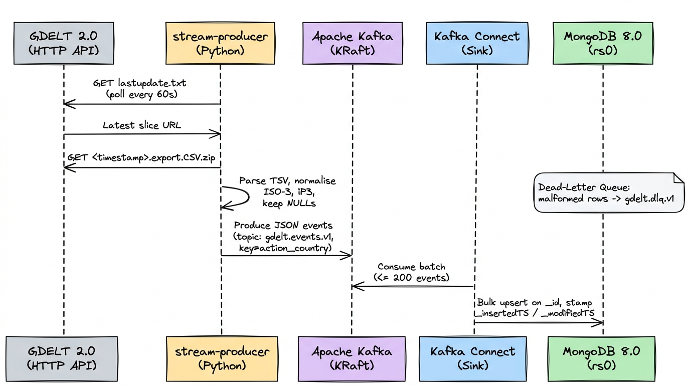

**Goal:** Inspect real-time event publishing from public news feeds into Kafka and MongoDB.

1. **Check the Stream Producer Logs:**
   ```bash
   docker logs stream-producer --tail 25
   ```
   You will see the producer polling `lastupdate.txt`, parsing the latest 15-minute export slice, and publishing JSON events to Kafka topic `gdelt.events.v1`.

2. **Verify Kafka Connect Status:**
   ```bash
   curl -s http://localhost:8083/connectors/mongo-sink-market-data/status | jq .
   ```
   The sink connector should report `"state": "RUNNING"` for both connector and tasks.

3. **Peek at a Real Event in Kafka:**
   ```bash
   docker exec -e KAFKA_HEAP_OPTS="-Xmx128M" kafka /opt/kafka/bin/kafka-console-consumer.sh \
     --bootstrap-server kafka:9092 --topic gdelt.events.v1 --from-beginning --max-messages 1 2>/dev/null | jq .payload
   ```
   You will see one event as JSON: the actors (`actor1_name`, `actor2_name`), the CAMEO `event_code`, `quad_class`, `goldstein_scale` (-10 to +10), `avg_tone`, and location.

   ⚠️ **Keep `-e KAFKA_HEAP_OPTS="-Xmx128M"`.** The console consumer starts a second Java process inside the Kafka broker's 1 GB container; without a small heap, the broker can be killed for running out of memory.

4. **Verify Incoming Documents in MongoDB:**
   ```bash
   docker exec mongodb mongosh --quiet --eval "db.getSiblingDB('market_data').events.countDocuments()"
   ```
   Run this command over a 15-minute window; the count will increase by 1,000–3,000 events with each newly published GDELT slice.

---

### Lab 2: Operational Hot Tier & Presto Schema Pinning

**Goal:** Understand how Presto translates NoSQL JSON documents into strictly typed SQL tables.

MongoDB documents are polymorphic by nature, but Presto requires strict SQL schemas. Open [`infra/mongodb/init-schema.js`](infra/mongodb/init-schema.js) to see the `_schema` collection pinning.

Query the live hot tier directly using Presto:
```bash
docker exec presto-coordinator presto-cli --output-format ALIGNED --execute "
  SELECT action_country, count(*) as event_count, avg(goldstein_scale) as avg_stability
  FROM mongodb.market_data.events
  GROUP BY action_country
  ORDER BY event_count DESC
  LIMIT 5;
"
```
*Notice how Presto executes full distributed aggregations directly over live MongoDB documents!*

---

### Lab 3: Historical Batch Backfill (Spark → Iceberg Silver)

**Goal:** Execute a bulk historical backfill directly into Apache Iceberg without swamping MongoDB.

1. Open Airflow at [http://localhost:8081](http://localhost:8081) (`admin` / `admin`).
2. Find the DAG **`backfill_gdelt_archives`**.
3. Click the **Trigger DAG** button (Play icon on the right).
4. Watch the DAG progress through:
   * `download_and_stage_archives`: Multi-threaded HTTP fetch of historical daily slices into `/tmp/lakehouse/landing`.
   * `spark_load_archives_to_iceberg`: PySpark executes schema transformation and an ACID `MERGE INTO` Iceberg Silver.
   * `deploy_presto_serving_views`: Deploys the unified serving view.
   * `trigger_lakehouse_sync`: Kicks off an immediate hot-to-cold sync.

Verify the loaded Silver data in Presto:
```bash
docker exec presto-coordinator presto-cli --output-format ALIGNED --execute "
  SELECT count(*) as total_silver_events, min(event_date) as earliest_date, max(event_date) as latest_date
  FROM iceberg.silver_gdelt.events;
"
```

> [!NOTE]
> `earliest_date` can be years in the past. `event_date` is when an event *happened* according to the article (GDELT `SQLDATE`); news often references past events ("a year ago", "ten years ago"). `event_time` is when GDELT *published* the record (`DATEADDED`).

See how many events came from each path (`archive` = this backfill, `stream` = live events synced from MongoDB):
```bash
docker exec presto-coordinator presto-cli --output-format ALIGNED --execute "
  SELECT source, count(*) AS events, min(event_time) AS first_added, max(event_time) AS last_added
  FROM iceberg.silver_gdelt.events GROUP BY source"
```
Re-running the backfill does not double the `archive` count: the `MERGE INTO` matches on `global_event_id`, so the load is idempotent.

To see which days you downloaded, use `event_time` (the default backfill is the 2 full days before today, UTC):
```bash
docker exec presto-coordinator presto-cli --output-format ALIGNED --execute "
  SELECT min(event_time) AS first_added, max(event_time) AS last_added, count(*) AS events
  FROM iceberg.silver_gdelt.events WHERE source = 'archive'"
```

**Changing the backfill size:** set `BACKFILL_DAYS` (number of days) and optionally `SLICES_PER_DAY` (15-minute files per day, `96` = full day) in `.env`, then recreate Airflow and clear previously staged files before triggering the DAG again ([Lab 9, Option B](#option-b-clear-staged-archives-only)):
```bash
docker compose up -d airflow
docker exec airflow rm -rf /tmp/lakehouse/landing/gdelt/extracted /tmp/lakehouse/landing/gdelt/downloads
```

> [!WARNING]
> Each full day is roughly 100k–250k events. The loader merges all staged files in a single Spark job, and with the default Spark memory settings a 30-day backfill (~3M rows) fails with executor out-of-memory errors (exit code `52`). Keep backfills to a few days unless you increase Spark executor memory.

---

### Lab 4: Lakehouse Storage Internals & Hive Metastore

**Goal:** Inspect physical Parquet files, metadata manifests, and snapshots in MinIO and Hive Metastore.

1. Open the **MinIO Console** at [http://localhost:9001](http://localhost:9001) (`minioadmin` / `minioadmin`).
2. Navigate to bucket `lakehouse` $\rightarrow$ `warehouse` $\rightarrow$ `silver_gdelt.db` $\rightarrow$ `events`. (Hive Metastore stores each schema as a `<name>.db` folder; you will also see `gold_gdelt.db` and an empty `gdelt_serving.db`, since views have no data files.)
3. Notice two subdirectories:
   * `data/`: Contains snappy/zstd compressed columnar **Parquet files** partitioned by `event_date_year=.../action_country=...`.
   * `metadata/`: Contains Iceberg **snapshot JSON files**, **manifest lists**, and **manifest files**.
4. Query Iceberg's metadata tables using Spark SQL to inspect snapshot history:
   ```bash
   docker exec spark-master /opt/spark/bin/spark-sql \
     --conf spark.sql.catalog.iceberg.type=hive \
     --conf spark.sql.catalog.iceberg.uri=thrift://hive-metastore:9083 \
     -e "SELECT snapshot_id, committed_at, operation FROM iceberg.silver_gdelt.events.snapshots ORDER BY committed_at DESC LIMIT 10;"
   ```
   The same metadata is available from Presto (faster, no Spark startup):
   ```bash
   docker exec presto-coordinator presto-cli --output-format ALIGNED --execute '
     SELECT snapshot_id, committed_at, operation
     FROM iceberg.silver_gdelt."events$snapshots" ORDER BY committed_at DESC LIMIT 10'
   ```

---

### Lab 5: Incremental Lakehouse Sync & Change Watermarking

**Goal:** Observe how live MongoDB events are continuously synced into Apache Iceberg every 5 minutes.

1. In Airflow, locate the **`sync_mongo_to_iceberg`** DAG (scheduled to run every 5 minutes).
2. The sync job executes [`jobs/sync_mongo_to_iceberg.py`](jobs/sync_mongo_to_iceberg.py):
   * Reads the current cursor from `iceberg.silver_gdelt.sync_state`.
   * Scans MongoDB for documents where `_modifiedTS >= cursor`.
   * Executes an ACID `MERGE INTO iceberg.silver_gdelt.events` matching on `global_event_id`.
   * Writes the new high-water mark back into `sync_state`.
   * Incrementally refreshes the last 7 days in `gold_gdelt.country_stability_daily`.

Inspect the audit trail in `sync_state`:
```bash
docker exec presto-coordinator presto-cli --output-format ALIGNED --execute "
  SELECT table_name, cursor_modified_ts, max_event_id, synced_at 
  FROM iceberg.silver_gdelt.sync_state 
  ORDER BY synced_at DESC 
  LIMIT 5;
"
```

To see the sync count so far:
```bash
docker exec presto-coordinator presto-cli --output-format ALIGNED --execute "
  SELECT table_name, count(*) AS runs
  FROM iceberg.silver_gdelt.sync_state GROUP BY table_name"
```
Expect `mongo_sync` (one row per 5-minute sync) and `batch_backfill` (one row per Lab 3 backfill run).

---

### Lab 6: Data Quality Gates & Orchestration in Airflow

**Goal:** Learn where data is cleaned, where it is checked, and where a Data Quality (DQ) gate stops bad data from reaching the analytical Gold layer.

1. In Airflow, look at **`build_gold_daily`**.
2. Notice the task dependency:
   `spark_data_quality_gate` $\rightarrow$ `spark_build_gold_tables`.
3. The data quality gate runs [`jobs/dq_checks.py`](jobs/dq_checks.py), which performs 7 checks (the same script also runs hourly as the `data_quality_audits` DAG):

   | # | Check | Table | Fails when |
   |:--|:---|:---|:---|
   | 1 | Primary key uniqueness | `silver_gdelt.events` | `count(*) ≠ count(DISTINCT global_event_id)`, **or the table is empty** |
   | 2 | Goldstein bounds | `silver_gdelt.events` | any `goldstein_scale` outside $[-10, +10]$ |
   | 3 | Coordinate validity | `silver_gdelt.events` | any latitude outside $[-90, 90]$ or longitude outside $[-180, 180]$ (nulls allowed) |
   | 4 | Timestamps present | `silver_gdelt.events` | no `event_time` at all (also prints earliest/latest dates and last sync time) |
   | 5 | ISO-3 country codes | `silver_gdelt.events` | any `action_country` null, empty, or not 3 characters |
   | 6 | Gold rollup sanity | `gold_gdelt.country_stability_daily` | `total_events < conflict + cooperation`, mean Goldstein out of range, or bad country (skipped while Gold is empty) |
   | 7 | Zero double-counting | `gdelt_serving.vw_gdelt_events_unified` (via Presto) | duplicate IDs across the hot/cold split, view missing, or 0 rows |

   The checks **detect, they don't fix**: any failure exits with code 1, the Airflow task fails, and Gold is not rebuilt. On a fresh stack, checks 1 and 7 fail until the first sync or backfill has run.
4. **Try triggering `build_gold_daily` manually:** Notice how the task passes once Silver is populated and successfully constructs the Gold tables!

#### Where Cleaning, Checks, and Gates Apply

Cleaning, checking, and blocking happen at different places in the pipeline:

```text
GDELT ─[clean]─▶ Kafka ─▶ MongoDB ─[clean]─▶ Silver ─[CHECK + GATE]─▶ Gold
                          (no checks)          ▲  (checked hourly, alert only)
                                               │
GDELT archives ──────────────────[clean]───────┘
```

| Layer | Cleaning | Quality checks |
|:---|:---|:---|
| **MongoDB** (hot tier) | **Light**, in the producer: UTC dates, empty fields → `null`, FIPS → ISO-3 country codes, `_id`. Unparseable lines go to the `gdelt.dlq.v1` dead-letter topic | **None.** Values such as the Goldstein range are not validated |
| **Silver** | **Yes**, in the Spark sync and backfill: type casts, invalid countries → `WLD`, empty actor names → `""`, per-batch deduplication | **Checks 1–5, after the data has landed**: hourly as an alert (`data_quality_audits`) and daily as the gate before Gold. Nothing blocks bad data from *entering* Silver |
| **Gold** | **None**, only aggregation of Silver | **Gated**: Silver is checked *before* `build_gold.py` runs. Check 6 audits the Gold table itself on the next run |
| **Serving view** | None (reads Silver + MongoDB as-is) | Check 7 only (no duplicates), hourly, alert only |

> [!IMPORTANT]
> **Two gaps to be aware of:**
> * The **MongoDB part of the unified view** (events not yet synced) is never validated, so dashboards on `mongodb.*` or `vw_gdelt_events_unified` can show unchecked recent data.
> * The **5-minute sync also refreshes the last 7 days of `country_stability_daily`** *without* the gate. That keeps the table nearly live, but bad Silver data can reach it before the hourly audit notices. Freshness is traded for safety.

**In production**, platforms usually check at *every* layer boundary and quarantine bad rows rather than only failing the job. Common tools are dbt tests, Great Expectations, Soda, and Deequ. Iceberg also supports **Write-Audit-Publish (WAP)**: writers commit to a table branch, checks run on the branch, and only passing data is published to `main`, so readers never see unchecked rows.

#### How `build_gold_daily` Works

`build_gold_daily` turns the detailed event table (`silver_gdelt.events`) into three summary tables that dashboards can query quickly. It runs every day at 01:00 UTC and has two tasks:

```text
spark_data_quality_gate  ──▶  spark_build_gold_tables
  (jobs/dq_checks.py)           (jobs/build_gold.py)
```

* **Quality gate:** runs the 7 checks from step 3. If any check fails, the task fails and this DAG does not rebuild the Gold tables, so bad Silver data never reaches them through the daily build (see the sync caveat above).
* **Build Gold:** runs `build_gold.py`, which recalculates the three tables from Silver.

#### The Three Gold Tables

| Table | Grain | What it answers | Window |
|:---|:---|:---|:---|
| `country_stability_daily` | One row per country per day | How stable did each country look on each day? | Last 90 days (`MERGE`) |
| `global_conflict_matrix` | One row per country pair (`actor1` → `actor2`) | Who is in conflict or cooperating with whom? | Last 90 days (full overwrite) |
| `crisis_hotspots_summary` | One row per country per week | Which weeks had unusually many events compared with the country's normal level? | Last 180 days (`MERGE`) |

> [!NOTE]
> `crisis_hotspots_summary` needs many weeks of history to be meaningful. A week is flagged when its event count is more than 2 standard deviations above the country's weekly average, and with *n* weeks of data the largest possible z-score is $\sqrt{n-1}$. So nothing can be flagged until there are at least 6 weeks of data (8–12 weeks for realistic results). With the default 2-day backfill, most countries have only one or two weeks, so z-scores are `0` or `±1` and no anomalies are flagged.

**Query: most unstable countries over the last 2 days**
```bash
docker exec presto-coordinator presto-cli --output-format ALIGNED --execute "
  SELECT action_country, sum(total_events) AS events, round(avg(mean_goldstein_scale), 2) AS stability,
         sum(high_impact_crises) AS crises
  FROM iceberg.gold_gdelt.country_stability_daily
  WHERE event_date >= CURRENT_DATE - INTERVAL '2' DAY
  GROUP BY 1 HAVING sum(total_events) > 500 ORDER BY stability LIMIT 10"
```

**Query: country pairs with the most conflict**
```bash
docker exec presto-coordinator presto-cli --output-format ALIGNED --execute "
  SELECT actor1_country, actor2_country, interaction_count, conflict_count, avg_goldstein_score
  FROM iceberg.gold_gdelt.global_conflict_matrix
  ORDER BY conflict_count DESC LIMIT 10"
```

---

### Lab 7: Zero-Duplicate Federated Serving in Presto

**Goal:** Query the unified view that bridges the hot and cold tiers with zero duplicated rows.

Open the Presto CLI and run the query across the unified serving view:
```bash
docker exec presto-coordinator presto-cli --output-format ALIGNED --execute "
  SELECT storage_tier, count(*) AS events, count(DISTINCT global_event_id) AS distinct_ids
  FROM iceberg.gdelt_serving.vw_gdelt_events_unified
  GROUP BY storage_tier"
```
*Expected Output:*
```text
 storage_tier | events              | distinct_ids
--------------+---------------------+---------------------
 iceberg      | <historical count>  | <same as events>
 mongodb      | <recent unsynced>   | <same as events>
```
*Notice how both tiers contribute to the same query and `events = distinct_ids`: no duplicate IDs! (See [Section 6.1](#61-the-zero-duplicate-unified-view-algorithm) for the math behind this).*

> [!NOTE]
> The `mongodb` row only contains events newer than the last sync, so right after a sync it can be `0` or missing. GDELT publishes every 15 minutes and the sync runs every 5.

**Try it: watch events move between tiers.**
1. In Airflow, **pause** `sync_mongo_to_iceberg` and wait for the next GDELT slice (up to 15 minutes).
2. Run the query above: the `mongodb` row now holds the new, unsynced events.
3. **Unpause** `sync_mongo_to_iceberg` and click **Trigger**. Wait until both tasks are green (about 1–2 minutes).
4. Run the query again: the `mongodb` count drops to `0` and `iceberg` grows by the same amount, with no duplicates, even though the events are still physically in MongoDB.

> [!WARNING]
> Don't leave the sync paused. The `purge_hot_tier` job only deletes events that are already synced, so MongoDB keeps growing while the sync is paused.

---

### Lab 8: BI Dashboards in Apache Superset

**Goal:** Connect Apache Superset to PrestoDB and explore the automated executive **GDELT Global Geopolitical Command Center** dashboard analyzing live operational news from MongoDB and historical Iceberg archives.

---

#### Step 1: Open Superset & Log In
* **URL:** [http://localhost:8088](http://localhost:8088)
* **Username:** `admin`
* **Password:** `admin`

---

#### Step 2: 1-Command Automated Dashboard Provisioning

Rather than manually clicking through dozens of UI modals to configure databases, datasets, metrics, and chart layouts, run the turnkey provisioning script:

```bash
docker exec superset python /app/provision_dashboard.py
```

> [!NOTE]
> Run this **after** `build_gold_daily` has succeeded at least once (Lab 6), so the Gold tables exist and their datasets get columns. The `SAWarning` lines in the output are harmless.
>
> If you see `can't open file '/app/provision_dashboard.py'`, your `superset` container was created before this script was added to the repo. Recreate it (Superset's data lives in Postgres, so nothing is lost) and run the command again:
> ```bash
> docker compose up -d superset
> ```

*What this automation does under the hood:*
1. **Registers the Presto Connection:** Provisions `presto://presto-coordinator:8080/iceberg` in Superset's metadata database and enables asynchronous SQL Lab execution.
2. **Registers the 3 Core Datasets:**
   * `iceberg.gdelt_serving.vw_gdelt_events_unified` (Federated Hot + Cold event view)
   * `iceberg.gold_gdelt.country_stability_daily` (Daily country-level conflict, cooperation, and mention aggregates)
   * `iceberg.gold_gdelt.global_conflict_matrix` (Bilateral actor dyad conflict matrix)
3. **Creates Calculated Columns:** Defines virtual expressions for CAMEO QuadClass categorizations (`event_category`) and rounded sentiment tone (`sentiment_tone`).
4. **Deploys 10 Production Charts & Responsive Grid:** Assembles an executive 4-row dashboard with 4 KPI cards, interactive world conflict heatmap, QuadClass distribution donut, 30-day conflict trajectory line, top media hotspots bar chart, bilateral conflict dyad table, and real-time breaking crisis ticker.

Once complete, open the dashboard directly:
👉 **[http://localhost:8088/superset/dashboard/gdelt-geopolitical-command-center/](http://localhost:8088/superset/dashboard/gdelt-geopolitical-command-center/)**

---

#### Step 3: Comprehensive 10-Chart Intelligence & Analytical Breakdown

Below is the complete architectural reference for all 10 tiles comprising the Command Center dashboard, including their visualization type, data source, underlying Presto SQL query, and analytical purpose.

#### Dashboard Overview & Real Visual Architecture

##### Row 1: Executive KPI Cards (Federated Scale & Stability Index)
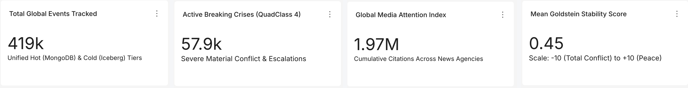

##### Row 2: Geospatial Conflict Heatmap & Macro-Diplomatic Balance
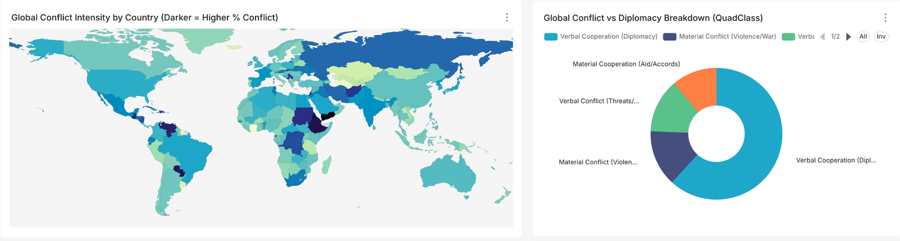

##### Row 3: Chronological Trends & Media Attention Spotlight
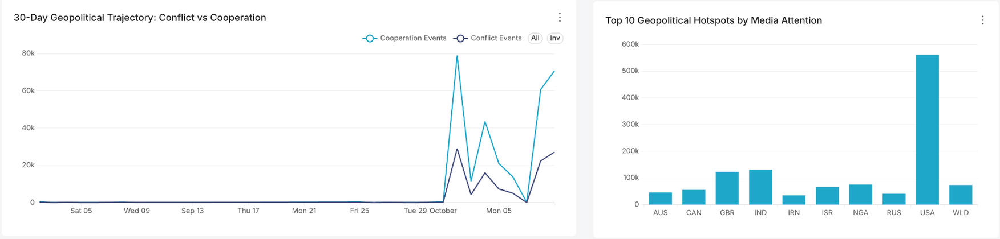

##### Row 4: Tactical Antagonist Dyads & Real-Time Incident Stream
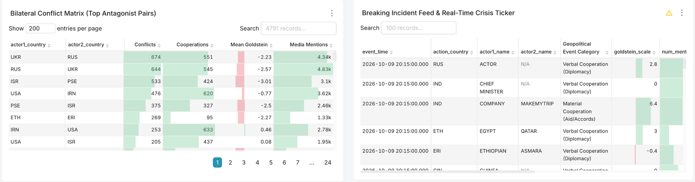

---

##### 1. Total Global Events Tracked
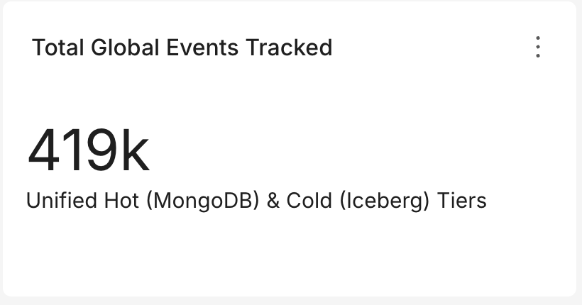
* **Visualization Type:** Big Number (`big_number_total`)
* **Data Source:** `iceberg.gdelt_serving.vw_gdelt_events_unified`
* **Underlying SQL Query:**
  ```sql
  SELECT COUNT(*) AS total_events
  FROM iceberg.gdelt_serving.vw_gdelt_events_unified;
  ```
* **Analytical Purpose:** High-level platform volume indicator. Quantifies the total aggregate volume of world events tracked across both operational MongoDB writes and cold historical Iceberg Parquet files. Serves as proof of zero-duplicate federation bridging hot and cold tiers.

---

##### 2. Active Breaking Crises (QuadClass 4)
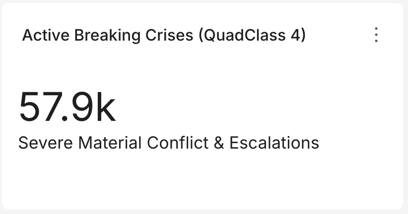
* **Visualization Type:** Big Number (`big_number_total`)
* **Data Source:** `iceberg.gdelt_serving.vw_gdelt_events_unified`
* **Underlying SQL Query:**
  ```sql
  SELECT COUNT(CASE WHEN quad_class = 4 THEN 1 END) AS active_crises
  FROM iceberg.gdelt_serving.vw_gdelt_events_unified;
  ```
* **Analytical Purpose:** Tactical operational threat gauge. CAMEO QuadClass 4 represents **Material Conflict** (military strikes, armed clashes, riots, physical violence). Analysts use this card as an immediate red-line alert for severe kinetic escalations occurring worldwide.

---

##### 3. Global Media Attention Index

* **Visualization Type:** Big Number (`big_number_total`)
* **Data Source:** `iceberg.gdelt_serving.vw_gdelt_events_unified`
* **Underlying SQL Query:**
  ```sql
  SELECT SUM(num_mentions) AS total_mentions
  FROM iceberg.gdelt_serving.vw_gdelt_events_unified;
  ```
* **Analytical Purpose:** Global media velocity index. Sums cumulative citations across thousands of monitored broadcast, print, and digital news agencies. Differentiates high-consequence global events covered by hundreds of international outlets from localized background noise.

---

##### 4. Mean Goldstein Stability Score
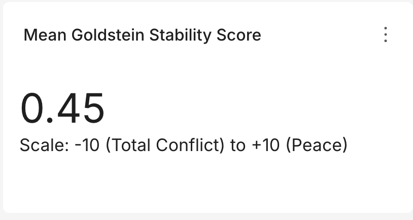
* **Visualization Type:** Big Number (`big_number_total`)
* **Data Source:** `iceberg.gdelt_serving.vw_gdelt_events_unified`
* **Underlying SQL Query:**
  ```sql
  SELECT ROUND(AVG(goldstein_scale), 2) AS mean_stability
  FROM iceberg.gdelt_serving.vw_gdelt_events_unified;
  ```
* **Analytical Purpose:** Macro-stability health barometer. The Goldstein scale assigns theoretical weights from `-10.0` (extreme destabilization / war) to `+10.0` (maximum stabilization / peace accords) to every CAMEO event code. A positive mean indicates baseline cooperative diplomacy, while downward shifts toward negative numbers signal rising international friction.

---

##### 5. Global Conflict Intensity by Country (Darker = Higher % Conflict)
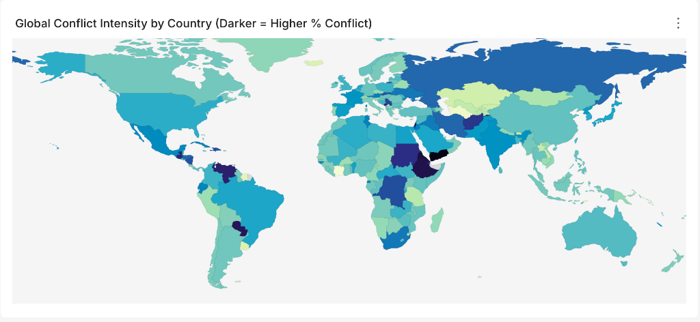
* **Visualization Type:** World Map (`world_map` with ISO-3 `cca3` country codes)
* **Data Source:** `iceberg.gold_gdelt.country_stability_daily`
* **Underlying SQL Query:**
  ```sql
  SELECT 
      action_country,
      ROUND(SUM(conflict_events) * 100.0 / NULLIF(SUM(total_events), 0), 1) AS conflict_rate_pct,
      SUM(total_events) AS total_incidents
  FROM iceberg.gold_gdelt.country_stability_daily
  GROUP BY action_country
  ORDER BY conflict_rate_pct DESC
  LIMIT 250;
  ```
* **Analytical Purpose:** Geospatial conflict density and hot-spot detection. Rather than shading countries by raw event counts (which distorts maps by over-representing media giants like the US with 120k+ mentions), this tile colors each nation by its **Conflict Rate (%)**:
  $$\text{Conflict Rate (\%)} = \frac{\sum \text{conflict\_events}}{\sum \text{total\_events}} \times 100$$
  Countries undergoing active military conflict or civil unrest (e.g., Yemen ~51%, Palestine ~50%, Ethiopia ~46%, Ukraine) render in darker, intense saturated colors, providing genuine situational intelligence regardless of geographic size or total news volume.

---

##### 6. Global Conflict vs Diplomacy Breakdown (QuadClass Donut)
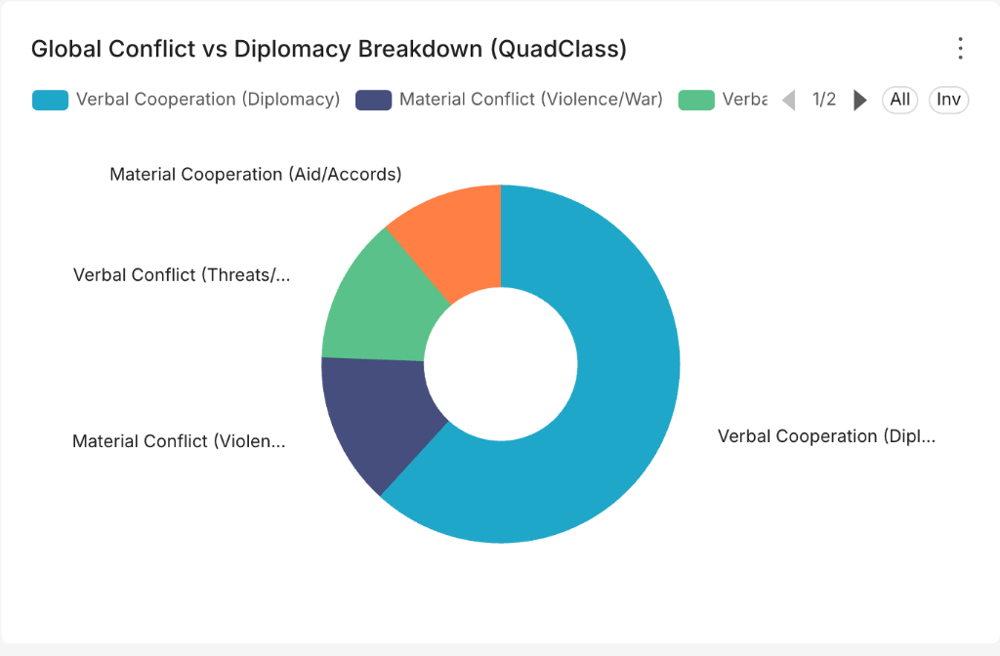
* **Visualization Type:** Donut Chart (`pie` with donut hole)
* **Data Source:** `iceberg.gdelt_serving.vw_gdelt_events_unified`
* **Underlying SQL Query:**
  ```sql
  SELECT 
      CASE 
          WHEN quad_class = 1 THEN 'Verbal Cooperation (Diplomacy)'
          WHEN quad_class = 2 THEN 'Material Cooperation (Aid/Accords)'
          WHEN quad_class = 3 THEN 'Verbal Conflict (Threats/Sanctions)'
          WHEN quad_class = 4 THEN 'Material Conflict (Violence/War)'
          ELSE 'Unclassified'
      END AS event_category,
      COUNT(*) AS event_count
  FROM iceberg.gdelt_serving.vw_gdelt_events_unified
  GROUP BY 1;
  ```
* **Analytical Purpose:** Macro-diplomatic balance of power. Categorizes all monitored international activity into the 4 mutually exclusive CAMEO QuadClasses. Instantly visualizes whether global interstate activity is predominantly steered by diplomatic accords (Verbal/Material Cooperation) or coercive measures (Verbal/Material Conflict).

---

##### 7. 30-Day Geopolitical Trajectory: Conflict vs Cooperation
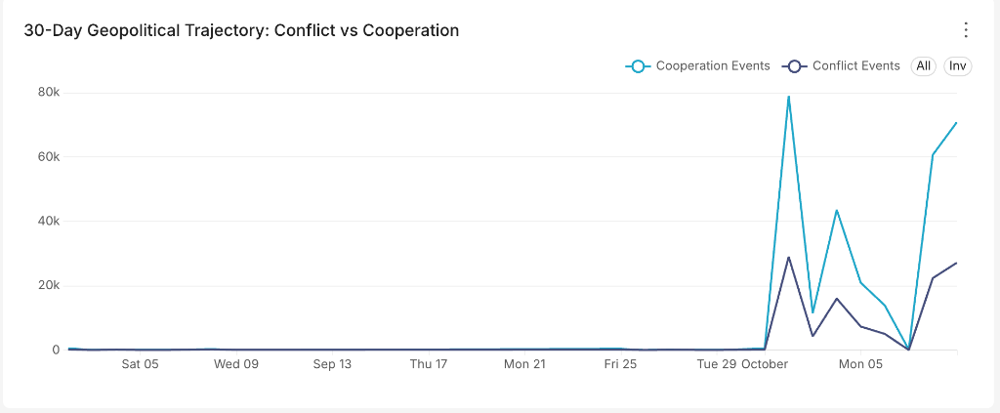
* **Visualization Type:** ECharts Line Chart (`echarts_timeseries_line`)
* **Data Source:** `iceberg.gold_gdelt.country_stability_daily`
* **Underlying SQL Query:**
  ```sql
  SELECT 
      date_trunc('day', CAST(event_date AS TIMESTAMP)) AS event_day,
      SUM(conflict_events) AS conflict_events,
      SUM(cooperation_events) AS cooperation_events
  FROM iceberg.gold_gdelt.country_stability_daily
  GROUP BY date_trunc('day', CAST(event_date AS TIMESTAMP))
  ORDER BY event_day ASC;
  ```
* **Analytical Purpose:** Chronological trend & anomaly identification. Plots the continuous daily trajectory of conflict events against cooperative events over a rolling 30-day window. Enables intelligence analysts to identify sudden divergence spikes (e.g. abrupt breakdown of peace talks or sudden military escalation) and assess medium-term stability trajectories.

---

##### 8. Top 10 Geopolitical Hotspots by Media Attention
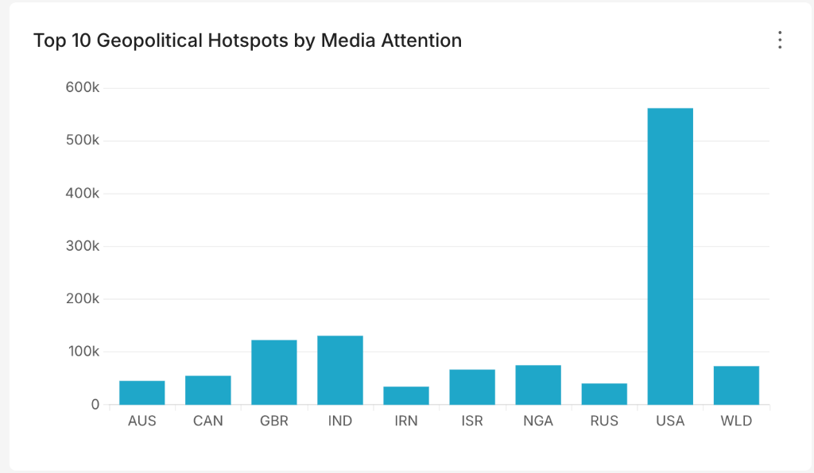
* **Visualization Type:** ECharts Bar Chart (`echarts_timeseries_bar`)
* **Data Source:** `iceberg.gold_gdelt.country_stability_daily`
* **Underlying SQL Query:**
  ```sql
  SELECT 
      action_country,
      SUM(total_mentions) AS total_media_citations
  FROM iceberg.gold_gdelt.country_stability_daily
  GROUP BY action_country
  ORDER BY total_media_citations DESC
  LIMIT 10;
  ```
* **Analytical Purpose:** Global media spotlight ranking. Identifies which nations are commanding the largest share of international media attention (e.g., USA, India, UK, Nigeria, Ukraine, Russia). Pinpoints where global press corps are concentrated and where public scrutiny is highest.

---

##### 9. Bilateral Conflict Matrix (Top Antagonist Pairs)
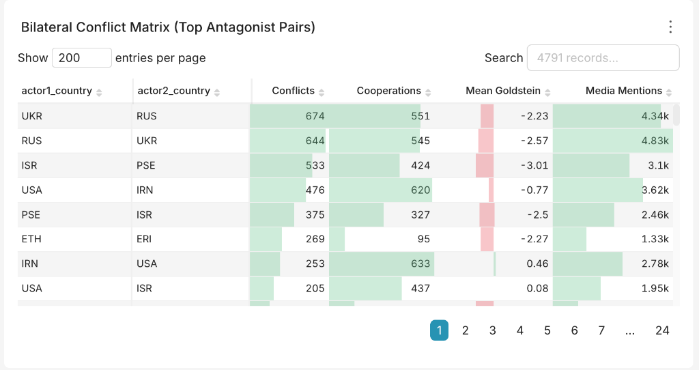
* **Visualization Type:** Interactive Table (`table` in aggregate mode with sorting & search)
* **Data Source:** `iceberg.gold_gdelt.global_conflict_matrix`
* **Underlying SQL Query:**
  ```sql
  SELECT 
      actor1_country,
      actor2_country,
      SUM(conflict_count) AS conflicts,
      SUM(cooperation_count) AS cooperations,
      ROUND(AVG(avg_goldstein_score), 2) AS mean_goldstein,
      SUM(total_media_coverage) AS media_mentions
  FROM iceberg.gold_gdelt.global_conflict_matrix
  GROUP BY actor1_country, actor2_country
  ORDER BY conflicts DESC
  LIMIT 50;
  ```
* **Analytical Purpose:** Bilateral state-to-state friction matrix. Evaluates direct adversarial interactions between national dyads (e.g., UKR $\rightarrow$ RUS, RUS $\rightarrow$ UKR, ISR $\rightarrow$ PSE, USA $\rightarrow$ IRN). Exposes which country pairings drive the highest conflict volume, their average hostility rating (`Mean Goldstein`), and whether any cooperative dialogue exists to counteract hostilities.

---

##### 10. Breaking Incident Feed & Real-Time Crisis Ticker
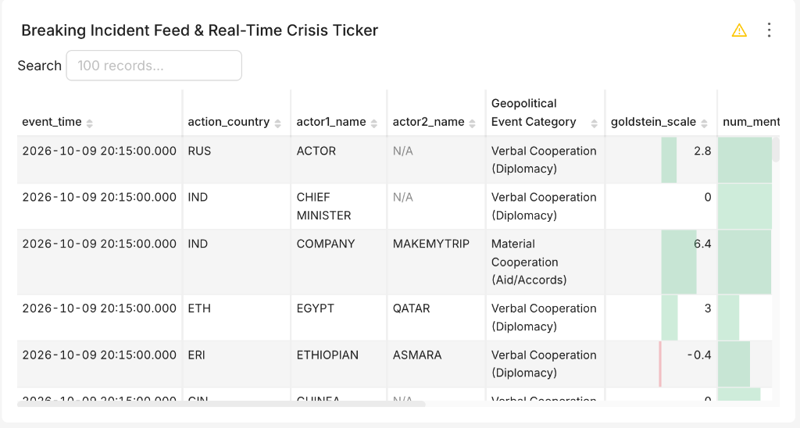
* **Visualization Type:** Raw Records Table (`table` with pagination & search)
* **Data Source:** `iceberg.gdelt_serving.vw_gdelt_events_unified`
* **Underlying SQL Query:**
  ```sql
  SELECT 
      event_time,
      action_country,
      actor1_name,
      actor2_name,
      CASE 
          WHEN quad_class = 1 THEN 'Verbal Cooperation (Diplomacy)'
          WHEN quad_class = 2 THEN 'Material Cooperation (Aid/Accords)'
          WHEN quad_class = 3 THEN 'Verbal Conflict (Threats/Sanctions)'
          WHEN quad_class = 4 THEN 'Material Conflict (Violence/War)'
          ELSE 'Unclassified'
      END AS event_category,
      goldstein_scale,
      num_mentions,
      ROUND(avg_tone, 2) AS sentiment_tone,
      source_url
  FROM iceberg.gdelt_serving.vw_gdelt_events_unified
  ORDER BY event_time DESC
  LIMIT 100;
  ```
* **Analytical Purpose:** Tactical operational situational awareness. Streams individual unaggregated event records sorted by descending timestamp (`event_time`). Allows crisis duty officers to inspect breaking developments emerging from the MongoDB hot tier in real time, examine involved entities (`actor1_name`, `actor2_name`), inspect article tone, and verify claims by clicking directly on `source_url`.

---

#### Step 4: Ad-Hoc Exploration in SQL Lab (Optional)

Superset is fully equipped with an interactive Presto SQL IDE:
1. In the top navigation bar, click **SQL Lab** $\rightarrow$ **SQL Editor**.
2. Select **Database:** `Presto (Lakehouse)` | **Schema:** `gdelt_serving`.
3. Run custom federated queries combining real-time MongoDB data and historical Iceberg tables in sub-second response times:
   ```sql
   -- Instant query comparing hot and cold tier counts
   SELECT storage_tier, count(*) as event_count
   FROM iceberg.gdelt_serving.vw_gdelt_events_unified
   GROUP BY storage_tier;
   ```

---

### Lab 9: Cleanup

**Goal:** Shut the lakehouse down, either pausing it with data kept or wiping it completely, and know exactly what each command removes.

#### Option A: Pause the Stack (Keep All Data)
Stops and removes containers but keeps every volume. The next `docker compose up -d` resumes with MongoDB events, Iceberg tables, Airflow history, and Superset dashboards intact.
```bash
docker compose down
```

#### Option B: Clear Staged Archives Only
The backfill downloader never deletes its files, and the Spark loader reads **every** staged CSV on each run. Clear them before re-running `backfill_gdelt_archives` with a different `BACKFILL_DAYS`, otherwise old days are reloaded too:
```bash
docker exec airflow rm -rf /tmp/lakehouse/landing/gdelt/extracted /tmp/lakehouse/landing/gdelt/downloads
```
Data already merged into Iceberg is not affected.

#### Option C: Full Cleanup (Wipe Everything)
Removes all containers, the project network, and all 7 named volumes:
```bash
docker compose down -v
```

| Volume | What is lost |
|:---|:---|
| `postgres_data` | Hive Metastore catalog, Airflow DAG run history, Superset connections & dashboards |
| `mongodb_data` | Hot tier events (`market_data.events`) |
| `minio_data` | All Iceberg tables: Parquet data files and snapshot metadata |
| `kafka_data` | Topics, messages, and consumer offsets |
| `lakehouse_staging` | Downloaded GDELT archives and the producer's last-processed-file state |
| `airflow_logs` | Airflow task logs |
| `spark_home` | Spark install copy (recreated from the image on next start) |

**What `down -v` does NOT remove:**

| Item | Why it survives | How to remove (optional) |
|:---|:---|:---|
| Docker images (~9 GB) | Images are shared, not owned by the project | `docker compose down -v --rmi all` |
| `infra/spark/jars/aws-java-sdk-bundle-1.12.262.jar` (~268 MB) | Host bind mount, auto-downloaded on first Spark start | Keep it, or the next startup re-downloads it |
| `pipelines/dags/__pycache__/` | Host bind mount written by Airflow | `rm -rf pipelines/dags/__pycache__` |
| `.env` | Your local configuration file | `rm .env` |
| Volumes from a **different project name** | `down -v` only removes volumes of the current project | See the note below |

> [!WARNING]
> Docker Compose prefixes volume names with the project name: `COMPOSE_PROJECT_NAME=gdelt-lakehouse` from `.env`, or the folder name (`presto_mongodb_workshop`) when there is no `.env`. If you ran the stack both with and without `.env`, there are two sets of volumes, and `down -v` only removes one of them. List and remove any leftovers:
> ```bash
> docker volume ls | grep -E 'gdelt-lakehouse_|presto_mongodb_workshop_'
> docker volume rm <volume-name> ...
> ```

> [!CAUTION]
> Avoid `docker system prune -a --volumes` for this cleanup. It deletes **all** unused images and volumes on your machine, including those from unrelated projects.

**Verify the cleanup:**
```bash
docker compose ps -a                                              # no containers
docker volume ls | grep -E 'gdelt-lakehouse_|presto_mongodb_workshop_'   # no volumes
```

#### Starting Fresh After a Full Cleanup
```bash
docker compose up -d
```
* MongoDB starts empty and refills from the live stream (one GDELT slice every 15 minutes).
* Iceberg tables are recreated by the first `sync_mongo_to_iceberg` run (~5 minutes).
* Re-run `backfill_gdelt_archives` (Lab 3) to reload historical data.
* Re-run the Superset provisioning script (Lab 8, Step 2) **after** `build_gold_daily` has run, so the Gold datasets have columns.

---

## 6. Core Architectural Deep-Dives

### 6.1 The Zero-Duplicate Unified View Algorithm

When data moves from Hot to Cold, an event temporarily exists in **both** MongoDB and Iceberg before the 48-hour hot-tier purge deletes it. A naive `UNION ALL` would result in duplicate rows.

To guarantee zero duplicate rows without expensive table joins, Presto dynamically partitions queries around the latest committed sync watermark $W$:
$$W = \max(\text{max\_event\_id}) \quad \text{where } \text{table\_name} = \text{'mongo\_sync'}$$

The unified view [`iceberg.gdelt_serving.vw_gdelt_events_unified`](jobs/deploy_presto_views.py) evaluates:
1. **From Iceberg:** Fetch records where `global_event_id <= W` (confirmed committed to storage).
2. **From MongoDB:** Fetch records where `global_event_id > W` (in-flight hot breaking records not yet synced).

```sql
WITH wm AS (
    SELECT COALESCE(max(max_event_id), 0) AS max_event_id
    FROM iceberg.silver_gdelt.sync_state
    WHERE table_name = 'mongo_sync'
)
SELECT CAST(e.global_event_id AS BIGINT), ..., 'iceberg' AS storage_tier
FROM iceberg.silver_gdelt.events e CROSS JOIN wm
WHERE e.global_event_id <= wm.max_event_id

UNION ALL

SELECT CAST(m.global_event_id AS BIGINT), ..., 'mongodb' AS storage_tier
FROM mongodb.market_data.events m CROSS JOIN wm
WHERE m.global_event_id > wm.max_event_id;
```
Because the sets $\{x \mid x \le W\}$ and $\{x \mid x > W\}$ are disjoint, double counting is mathematically impossible.

### 6.2 Idempotency & Precedence in ACID Merges

Both streaming and historical backfill ingestion pipelines can ingest the exact same event ID. To prevent older backfilled archives from overwriting newer real-time streaming updates, both Spark jobs enforce strict `_modifiedTS` precedence in their `MERGE INTO` statements:

```sql
MERGE INTO iceberg.silver_gdelt.events AS target
USING staged_batch AS source
ON target.event_date >= DATE '<min_batch_date>'
   AND target.global_event_id = source.global_event_id
WHEN MATCHED AND source._modifiedTS > target._modifiedTS THEN UPDATE SET ...
WHEN NOT MATCHED THEN INSERT ...
```

### 6.3 Alternative Architectures

The hot/cold split in this workshop is one of several common designs for combining streaming and batch data:

| Pattern | Idea | Example |
|:---|:---|:---|
| **Lambda** (this workshop) | Separate streaming and batch paths, merged at query time | MongoDB + Iceberg, unified by the Presto view |
| **Kappa** | A single streaming path; reprocess history by replaying the stream | Kafka (long retention) → Flink → Iceberg / Pinot |
| **Streaming lakehouse** | Stream directly into an open table format, keeping one copy of the data | Kafka → Flink / Spark Streaming → Iceberg, Hudi, Delta, or Paimon |

Where teams store streaming data depends on the question it must answer:

| If your question is… | Typical choice | In this design, it would replace… |
|:---|:---|:---|
| "Live dashboard, aggregated, in under a second" | Apache Pinot, Apache Druid, ClickHouse, StarRocks | MongoDB (hot tier) |
| "Analytics on minutes-old data, open formats, one copy" | Flink / Spark Structured Streaming → Iceberg, Hudi, Delta, Paimon | MongoDB plus the sync and purge DAGs |
| "Replay or reprocess history" | Kafka / Redpanda / Pulsar with long or tiered retention | The archive download for recent days |
| "Latest record for this ID" (apps, APIs) | MongoDB, Cassandra, DynamoDB, Redis | — (MongoDB's role here) |
| "Search text and logs" | Elasticsearch, OpenSearch | — (an additional sink from Kafka) |
| "Metrics over time" | InfluxDB, TimescaleDB, Prometheus | — |
| "SQL results that update continuously" | Materialize, RisingWave, Flink SQL | The Gold build for real-time aggregates |

> [!TIP]
> Presto has connectors for Kafka, Pinot, Druid, ClickHouse, Elasticsearch, Cassandra, and Redis, so the federated-query approach used here (including the watermark-based unified view) carries over when you swap the hot tier. The patterns stay the same: idempotent merges, high-water marks, quality gates, and one SQL layer on top.

---

## 7. Repository Map

```text
├── docker-compose.yml              # Complete 13-service container composition
├── .env.example                    # Template environment variables and credentials
├── README.md                       # Master workshop guide and documentation
├── images/                         # Architectural diagrams and flowcharts
├── ingestion/
│   ├── stream_producer/producer.py # GDELT 2.0 60-second poller & Kafka publisher
│   └── batch/download_archives.py  # Parallel historical archive slice downloader
├── jobs/
│   ├── load_archives_to_iceberg.py # Historical bulk load MERGE into Iceberg Silver
│   ├── sync_mongo_to_iceberg.py    # 5-minute Hot->Cold incremental sync & Gold refresh
│   ├── build_gold.py               # Nightly analytical aggregation of Gold tables
│   ├── dq_checks.py                # 7 automated Data Quality gate checks
│   ├── deploy_presto_views.py      # Deploys cross-catalog zero-duplicate Presto view
│   └── maintenance.py              # Iceberg binpack file compaction & snapshot expiry
├── pipelines/dags/
│   └── gdelt_lakehouse_dags.py     # Airflow DAG suite (Backfill, Sync, Gold, Purge, Maint)
└── infra/                          # Infrastructure configuration files
    ├── kafka-connect/              # Distributed connect properties & MongoDB sink JSON
    ├── mongodb/                    # Replica set bootstrap & Presto _schema definition
    ├── postgres/                   # Database initialization script
    ├── hive-metastore/             # HMS XML configuration & JDBC driver setup
    ├── spark/                      # spark-defaults.conf, S3A settings & dependency JARs
    ├── presto/                     # Coordinator/worker configs, catalogs & JVM tuning
    └── superset/                   # Init automation script & Superset configuration
```

---

## 8. Troubleshooting & Operations Guide

### 8.1 Presto Memory Tuning
Presto's internal `LocalMemoryManager` requires:
$$\text{query.max-total-memory-per-node} + 0.3 \times \text{available\_heap} \le \text{available\_heap}$$

In this project, memory is precisely tuned to avoid OOM crashes:
* **Coordinator:** Heap `1024M` (`-Xmx1024M`), `query.max-memory-per-node=512MB`, `query.max-total-memory-per-node=650MB`.
* **Workers:** Heap `1400M` (`-Xmx1400M`), `query.max-memory-per-node=600MB`, `query.max-total-memory-per-node=800MB`.

### 8.2 Apple Silicon (M1/M2/M3/M4) Note
The official `apache/hive:3.1.3` image is built for `linux/amd64`. In [`docker-compose.yml`](docker-compose.yml), it is pinned to `platform: linux/amd64`. On Apple Silicon Macs, Docker Desktop automatically executes it via Rosetta 2 emulation. Because Hive Metastore functions strictly as a lightweight Thrift metadata catalog, CPU and memory usage remain negligible ($< 0.5\%\text{ CPU}$).

### 8.3 Resetting the Workshop Environment
To cleanly wipe all persistent data, Kafka offsets, and databases to start fresh:
```bash
docker compose down -v
docker compose up -d
```
See [Lab 9: Cleanup](#lab-9-cleanup) for exactly what this removes and what it leaves behind.
